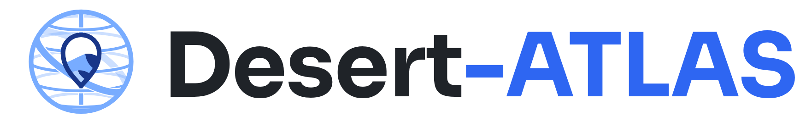

<picture>
  <source media="(prefers-color-scheme: dark)" srcset="./assets/desert-atlas-logo-dark.png">
  
</picture>

**Mapping food and activity deserts in rural Europe — so communities and institutions can see the gaps, and act on them.**

A geospatial observatory developed within the <b>UNITA – Universitas Montium</b> alliance.

 

---

## 🌍 About

In many rural and mountain regions, essential services — grocery stores, pharmacies, sports facilities, cultural spaces — are disappearing. The places left behind become **deserts**: areas where people must travel unreasonable distances for everyday needs.

**Desert ATLAS** builds the tools to make those deserts visible. We combine open geospatial data with a machine-learning pipeline to classify every area of a region, and we put the results in the hands of the people who live there and the institutions that serve them.

- 🥖 **Food deserts** — limited access to fresh, affordable food.
- 🏃 **Activity deserts** — limited access to sport, leisure and social activity.

<!-- TODO: add university, course and supervisor, e.g.
This project was developed as the final-year project of the Bachelor's in <course> at <university>, supervised by <name>.
-->

## 👥 Team

<table>
  <tr>
    <td align="center" valign="top" width="200">
      <a href="https://github.com/Fegue3">
         
        <b>Francisco</b>
      </a> 
      Backend · Web · ML pipeline · Infra  
      
      <!-- TODO: <a href="https://www.linkedin.com/in/<handle>"></a> -->
    </td>
    <td align="center" valign="top" width="200">
      <a href="https://github.com/JaamesTheFirst">
         
        <b>Tiago Marques</b>
      </a> 
      Backend · Mobile · ML pipeline · Infra  
      
      <!-- TODO: <a href="https://www.linkedin.com/in/<handle>"></a> -->
    </td>
  </tr>
</table>

## 📬 Contact

Interested in the project, the data, or a collaboration? Reach out to any team member through the links above.

<!-- TODO: add a shared team address instead of personal emails, e.g.
📧 <a href="mailto:team@example.com">team@example.com</a>
-->

## 🙏 Acknowledgements

- **UNITA – Universitas Montium**, for the context and challenge behind this project.
- Open data from **[OpenStreetMap](https://www.openstreetmap.org/copyright)** contributors, **[Eurostat](https://ec.europa.eu/eurostat)** and the **[Global Human Settlement Layer](https://human-settlement.emergency.copernicus.eu/)**.
<!-- TODO: thank supervisors / university -->

---

Made with ☕ by the Desert ATLAS team · 2026

